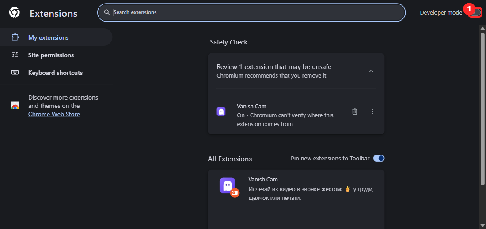
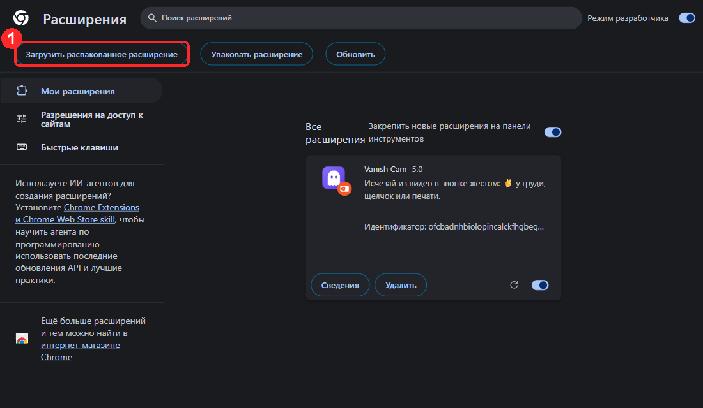
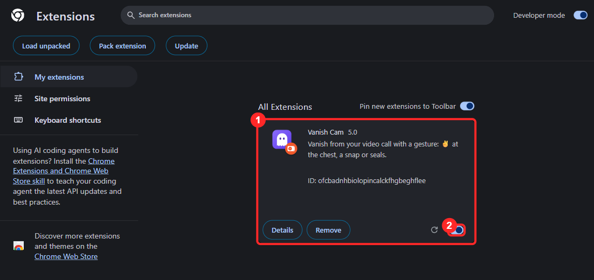
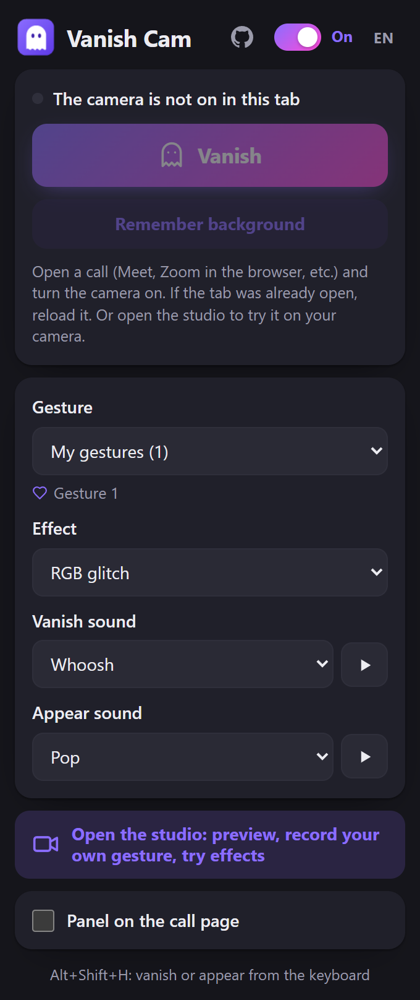
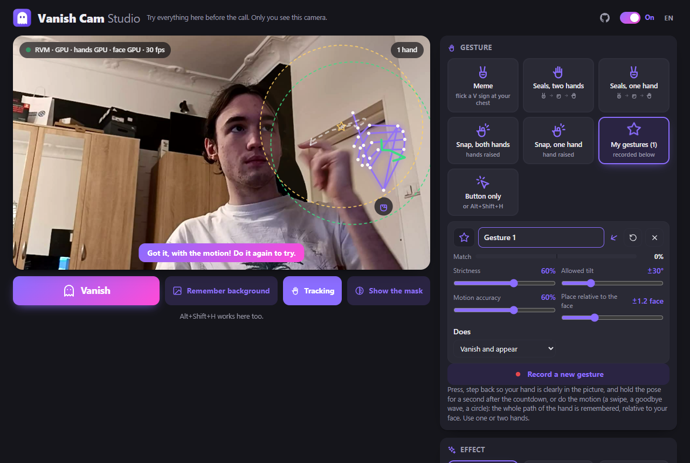

# Vanish Cam

Chrome (MV3) extension for web video calls (tested on Google Meet). It cuts you out of your camera
picture, keeps the live background, and makes you vanish on a gesture, with an optional sound effect.

- Gestures: ✌️ at the chest (meme), Naruto-style seals, finger snap (one or two hands), **your own recorded gestures**, or just a button / `Alt+Shift+H`.
- Effects in the style of video-editor transitions: Thanos disintegrate, flash teleport, RGB glitch, zoom punch, smoke puff, glass shatter, soft dissolve, hard cut with a flash. The effect starts right away; the sound is started part-way in so its hit lands on the effect.
- One main switch (popup and studio header) turns everything off: the camera goes out untouched and the toolbar icon shows OFF.
- Sounds: built-in synthesised ones (whoosh, pop, poof, sparkle, teleport, zap, boom, bubble) or your own files; the call hears them too.
- **Studio** page: your camera through the real pipeline with the hand tracking drawn on top, record a gesture with a countdown, try effects and sounds, all settings.
- Cutout: Robust Video Matting (ONNX, WebGPU, falls back to CPU) or a faster MediaPipe segmenter.
- Hands and face: MediaPipe HandLandmarker / FaceDetector. Everything runs locally in the browser.

## Install and use

**Easiest: install from the Chrome Web Store** (updates come automatically):
**[Vanish Cam in the Chrome Web Store](https://chromewebstore.google.com/detail/vanish-cam/ohooblpnadanabnffhklbbncelbnmhao)**, then click **Add to Chrome**.

Or install it by hand from this repository (steps below). Either way it runs only on your computer and sends nothing anywhere.
Works in Chrome, Edge and Brave.

### 1. Download and unpack

1. Download `vanish-cam.zip` from the **Releases** page of this repository.
2. Unpack it: right-click, **Extract All…** (Windows) or double-click (Mac).
3. Put the `vanish-cam` folder somewhere permanent, for example Documents. **Don't delete or move it afterwards**: Chrome runs the extension straight from that folder.

### 2. Open the extensions page and turn on Developer mode

1. Type `chrome://extensions` in the address bar and press Enter.
2. Switch on **Developer mode** in the top right corner (mark 1).



### 3. Load the folder

1. Click **Load unpacked** at the top left (mark 1).
2. Pick the `vanish-cam` folder (the one that contains `manifest.json`) and click **Select Folder**.



### 4. Done

A **Vanish Cam** card appears (mark 1). Make sure its switch is on (mark 2). To keep the icon handy, click the puzzle icon right of the address bar and pin Vanish Cam.



### 5. Use it

1. Open a call (Google Meet, Zoom in the browser, etc.) and **turn your camera on**. If the call tab was already open, reload it first (F5).
2. Click the Vanish Cam icon. The popup looks like this:

   

3. Pick a gesture (default: the meme, ✌️ flicked at your chest), an effect and sounds. Do the gesture and you vanish; do it again and you reappear.
4. No gesture handy? Press the **Vanish** button or `Alt+Shift+H`.
5. If something behind you changed and artifacts remain, press **Remember background** and step out of the frame for 5 seconds.

### The studio

Press **Open the studio** in the popup. It opens a page with your camera going through the same pipeline a call
would use, so you can see exactly what the models see and try everything before a call:



- The hands are drawn as the model tracks them (the **Tracking** button turns this off), with the pose it recognises (✌️ ✋ ✊ 🫰) and, for the meme gesture, the chest line.
- **Record a new gesture** (under *My gestures*): a 3-2-1 countdown, then hold the pose for a second. The median hand shape
  becomes the gesture; it matches anywhere in the frame, at any distance, with either hand. Each gesture has a live
  match meter, strictness, hold time, allowed tilt and what it does (vanish, appear, or both). Two hands work too.
- **Gestures with motion**: do the motion while recording (a swipe, a goodbye wave, a circle) and the whole path of
  the hand is remembered, relative to your face, so it works nearer to or further from the camera. It fires when the
  hand makes that path again (compared with dynamic time warping, so a quicker or slower wave still counts), starting
  and ending near the same place relative to your face. The studio draws the recorded path, the start and end zones
  and your hand's trail; each motion gesture has *Motion accuracy* and *Place relative to the face* sliders.
- Click an effect to see it on yourself. The **Vanish** button and `Alt+Shift+H` work here as well.
- Settings sit next to what they belong to:
  - under the gesture tiles, the selected mode's own thresholds (meme, seals, snap);
  - under the effect tiles, the selected effect's own sliders: duration plus e.g. dust spread and grain, flash
    brightness and glow colour, glitch tear and shake, number of shards. Letting go of a slider replays the effect;
  - in the sounds card, sound timing and volumes;
  - **General** has the compute / cutout model choice, model speed, the background timer and the debug switches.

### Troubleshooting

| What you see | What to do |
|---|---|
| The popup says the camera isn't on for this tab | Reload the call tab and turn the camera on |
| Video is slow | Open the gear in the popup, set the compute option to GPU and the cutout model to the simple one |
| Artifacts around you | Step out of the frame for 5 seconds and press "Remember background" |
| Chrome warns about "developer mode extensions" at startup | Close the warning; the extension stays. It is normal for manual installs |
| The extension disappeared | The `vanish-cam` folder was deleted or moved: repeat steps 2–3 |

### Updating

Download the new zip, replace the files in the `vanish-cam` folder, press ↻ on the Vanish Cam card at `chrome://extensions` and reload the call tab.

## Sounds

Built-in sounds are synthesised in the browser (no audio files, nothing to license). To use your own, open the studio,
"Sounds", add audio files (mp3 or wav, up to 3 MB each); they appear in the lists (also reversed) next to the built-in ones.

## Tests

```
npm i puppeteer-core
node test/gestures.test.mjs
```

`test/studio.mjs` (records a gesture and plays an effect in the studio), `test/switch.mjs` (switches the cutout model and compute device back and forth), `test/popup.mjs`, `test/run.mjs`, `test/perf.mjs`
drive a real Chrome with a fake camera (pass the path to `chrome.exe`).

## Licenses

GPL-3.0 (see `LICENSE`), because it bundles the Robust Video Matting model (GPL-3.0).
Also bundled: MediaPipe tasks-vision and models (Apache-2.0), onnxruntime-web (MIT).
